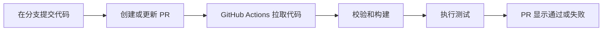

# PR 自动检查：从本地到 GitHub

入口文件：[tools/check_pr.py](../tools/check_pr.py)。自动执行配置：[.github/workflows/pr-checks.yml](../.github/workflows/pr-checks.yml)。

## 1. 先理解流程



GitHub Actions 是执行检查的环境，YAML 文件描述何时运行、用什么系统和执行哪些命令。测试在临时 runner 上运行；不使用游戏服务器，也不需要把 SSH 私钥放进仓库。

## 2. 本地先跑一次

需要 C++17 编译器、CMake、Python 3.10+，网页检查还需要 Node.js 20+ 和 npm。

```text
python tools/check_pr.py
```

脚本默认执行全部检查，遇到错误立即返回非零退出码。可分开运行：

```text
python tools/check_pr.py --suite native
python tools/check_pr.py --suite web
```

Windows 使用 MinGW 时，首次配置指定生成器：

```text
python tools/check_pr.py --generator "MinGW Makefiles"
```

当前工作站的 npm 不在 PATH 时，可以指定现有 npm 入口：

```text
python tools/check_pr.py --generator "MinGW Makefiles" --npm-cli .tools/npm/package/bin/npm-cli.js
```

原生构建位于 `build/pr-checks/`，不影响原来的 `build/`。切换不同编译器时可以用 `--build-dir build/another-check` 指定另一个目录。只跑网页时，可通过 `--engine` 指定已编译的服务器可执行文件。Windows 默认使用本机 Edge；可用 `BROWSER_PATH` 指向 Chrome。Linux runner 使用锁定版本的 Playwright Chromium；`--install-browser` 安装它及系统依赖，仅用于本机或 CI，不能在 2 GB 游戏服务器执行。

## 3. GitHub 怎样自动调用

工作流放在仓库的 `.github/workflows/pr-checks.yml`。当前触发器为：

```yaml
on:
  pull_request:
  push:
    branches: [main]
  workflow_dispatch:
```

- `pull_request`：创建 PR、继续向该 PR 分支推送提交、重新打开 PR 时自动检查。
- `push`：提交进入 main 时再检查，覆盖直接向 main 提交的情况。
- `workflow_dispatch`：允许在 GitHub 的 Actions 页面手动点击 Run workflow。

其中的 `run: python tools/check_pr.py --suite native` 就是在临时机器上执行同一个本地命令。PR 默认检查 GitHub 准备的合并结果；push 检查推送的提交。[GitHub 触发事件说明](https://docs.github.com/en/actions/reference/workflows-and-actions/events-that-trigger-workflows#pull_request)

## 4. 本项目检查什么

| 检查 | 作用 |
|---|---|
| 文档本地链接 | README、design 和 docs 引用的本地文件必须存在；不访问外部链接，也不验证 Markdown 锚点 |
| JSON 与生成文件 | 严格验证卡牌 JSON，检查头文件、实现、卡池注册是否同步，检测已删除 JSON 对应的残留生成文件；不自动修复 PR |
| Linux / Windows 原生构建 | 使用 CMake Debug 编译服务器；Debug 保留 C++ 测试断言 |
| CTest | 事件、上下文、完整对局、消耗牌、JSON 工厂、导入工具、检查入口和原生 TCP 测试 |
| 网页构建与网关 | 按 package-lock 安装依赖，打包网页，测试鉴权、状态隔离、重连和即时消耗牌 |
| 浏览器联机 | 四位玩家入座、购卡、使用消耗牌、发牌、出牌、刷新重连与手机横屏 |

Linux 跑原生和网页检查，Windows 跑原生检查；最后汇总为固定名称的 **PR checks**。任一平台失败、取消或未成功，汇总检查都不会显示通过。更新同一 PR 时，旧的未完成检查会取消。

工作流仅申请 `contents: read`，不部署、不写入仓库、不使用项目密钥。Actions 固定到经过核对的提交 SHA。测试日志和截图作为 artifacts 保留 7 天。[GitHub Token 权限说明](https://docs.github.com/en/actions/tutorials/authenticate-with-github_token)

## 5. 你平时怎么提交

在正常的 Git 克隆目录中执行以下流程。若工作目录没有 `.git`，先将仓库克隆到新的空目录，保留现有文件：

```text
git clone https://github.com/ywt-helloworld/pvp_cards_game.git
cd pvp_cards_game
git config user.name ywt.helloworld
git config user.email ywt.helloworld@gmail.com
git switch -c feature/my-change
```

修改代码或 JSON，生成需要更新的 C++ 文件，再执行本地检查：

```text
python tools/check_pr.py
git add README.md
git commit -m "docs: clarify game rules"
git push -u origin feature/my-change
```

上面的 `git add README.md` 是示例，提交时改为本次实际修改的文件。然后打开仓库的 Pull requests，点击 New pull request，选择 `base: main` 和自己的分支，创建 PR。进入 PR 的 Checks 页面查看结果。

检查失败时，点进失败的步骤，先看第一处报错，再下载日志或截图。在同一分支修复、提交、push；原 PR 会自动重新检查，不用再开新 PR。

## 6. 怎样做到“检查不过不能合并”

自动执行检查和禁止合并是两项独立配置。工作流先让结果出现在 PR 中；如果需要强制拦截，在仓库 Settings 的 Rulesets 或 Branches 中，为 main 设置“合并前必须通过状态检查”，选中 **PR checks**。需要该检查至少运行一次后才容易选到它。

是否同时要求必须经过 PR、管理员能否绕过、是否要求人工审批，由分支规则单独决定，本工作流不会擅自改变这些仓库设置。[受保护分支说明](https://docs.github.com/en/repositories/configuring-branches-and-merges-in-your-repository/managing-protected-branches/about-protected-branches)

## 7. 以后如何增加检查

- 新增 C++ 用例：在 `tests/` 加入测试，并在 `CMakeLists.txt` 注册；CTest 会自动带上它。
- 新增网关场景：加入 `web/tests/gateway.test.mjs`，现有 `npm test` 会执行。
- 新增浏览器场景：加入 `web/tests/browser.mjs`。
- 新增检查命令：加入 `tools/check_pr.py`。只有新增平台、环境安装或触发条件时才需要改工作流。

检查程序和 CI 的代码设计统一记录在 [design.md](../design.md#14-pr-自动检查)。
